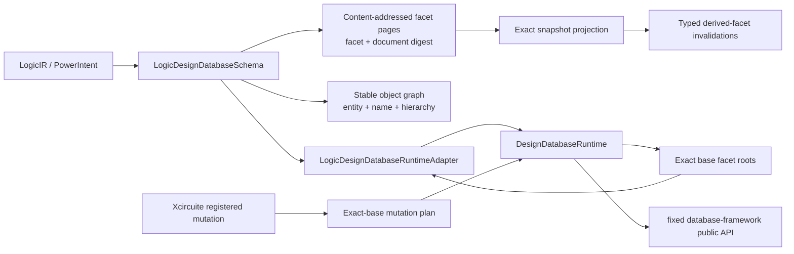

# LogicDesignDatabaseIntegration

Host-only DesignDatabase integration for canonical LogicDesign RTL, gate, and power-intent facets.



The portable `LogicDesign` package remains database independent. This package owns
canonical payload validation, bounded immutable content-addressed facet pages, stable
object-key mapping, the mechanical Runtime contribution, and exact snapshot projection.

Facet pages are keyed by facet identity and canonical document digest, so an immutable
facet root inherited by a later candidate resolves the same pages without copying or
revision-relative lookup. Gate and power-intent documents retain an exact-base RTL
source binding containing the base revision and canonical RTL root. Admission rejects a
missing, different-revision, or different-root binding with typed diagnostics. Exact
snapshot projection preserves inherited payloads and derives typed invalidation records
when the snapshot's RTL root no longer matches a derived facet binding; it never silently
deletes or recomputes the stale facet.

RTL, gate, and power-intent documents are also lowered into deterministic stable object
keys. The planner reads the exact base `.name` projection, preserves permanent entity and
relation-occurrence IDs for surviving keys, and requests provisional IDs only for new
keys. Runtime admission independently re-reads the exact base through the bounded
mutation-preparation query contract; omitted or stale prior identities fail typed before
publication. The adapter atomically contributes `.entity`, `.name`, and paired
`.hierarchy` changes with the canonical facet document.

The binding manifest is `v3` and the mutation adapter version is `3.0.0`. This is a
breaking replacement of the unpublished experimental representation; it is not a facet
migration and does not close the explicit migration task.

Each mutation plan changes one facet at one exact base revision. Candidate publication never changes `main`; promotion remains an Xcircuite and DesignFlowKernel policy path.

## Verification

```bash
swift build --build-tests -j 4 \
  -Xswiftc -Xfrontend -Xswiftc -disable-round-trip-debug-types
```

Xcircuite owns the registry/executor composition test because the compositor depends on
this integration package; this package does not reverse-depend on Xcircuite. The local
corpus covers multi-revision RTL/gate/power round trip, stable object and occurrence IDs,
object add/remove, exact paired hierarchy entries, omitted-before-state rejection,
source-root invalidation after RTL replacement, typed stale-import rejection, and
rejection-status reconciliation. A public-API smoke of the object projection path emitted
`logic-object-projection-smoke-ok: stable-id,add,remove,paired-hierarchy,exact-before-state`.
Retained CI execution evidence and migration remain open.

All package dependencies are exact remote releases. Local sibling resolution is not part
of the production or release contract.
